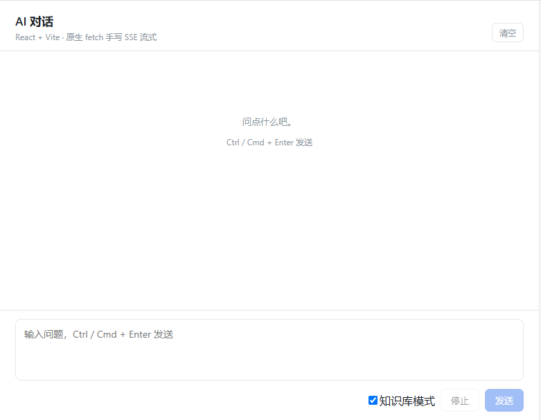
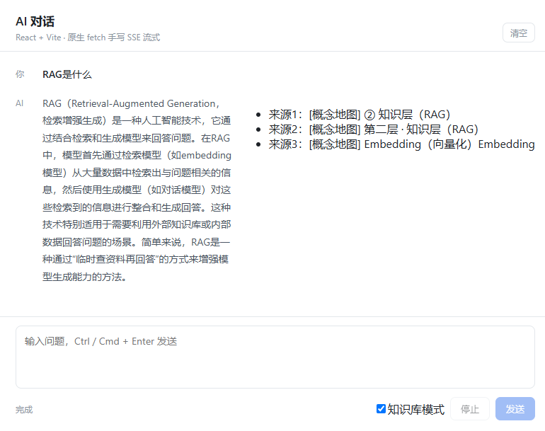
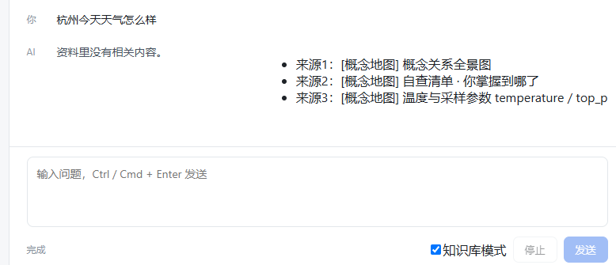

# ai-journey — AI 对话与知识库问答应用

> 从流式输出到 RAG 到 Function Calling，个人全栈实现的 LLM 应用演进项目
>
> 配套笔记：[前端转 AI 第一课：大模型其实是个会中途断线的异步接口](https://juejin.cn/post/7695437620618199094)

## 这是什么

三阶段长出来的全栈项目，每一段都在解决上一段暴露的问题：

- **阶段一：原生 fetch 手写 SSE** —— 不用任何 SDK，从字节流开始拆解流式协议，搞懂「AI 回答为什么是一个字一个字蹦出来的」
- **阶段二：RAG 全链路** —— 文档切分 → 向量化 → 相似度检索 → 提示词约束 → 生成，用自己的学习笔记做知识库，库外问题拒答
- **阶段三：Function Calling 与架构保证** —— 实测模型「自觉调工具」不可靠，把首轮检索移到应用层由代码无条件执行

## 效果演示

完整页面：



基于我的知识库回答（带来源引用）：



知识库里没有相关内容时，拒答而不是编造：



## 架构

```
web-react（React + Hooks + useChatStream）
   │  fetch POST /ask，SSE 流式解析（半包 buffer、失败重试、中途停止）
   ▼
server/app.py（FastAPI）
   │  /ask：接收问题
   ▼
search.py：问题向量化 → 与向量索引算余弦相似度 → 取 top-k
   │                ▲
   │                └── data/ 向量索引（chunk.py 切分 → embed.py 批量向量化）
   ▼
提示词组装（编号资料 + 防幻觉约束）→ GLM-4 生成 → SSE 回传前端
```

## 核心亮点

**① 评测驱动检索调优**：自建评测集（15 题 / 45 检索槽位）量化检索质量。切分从「整块硬切」改为「`###` 参与切分」后，基线从 6/15 → 7/15；扩题到 v2 后基线 18/45（40%）。同义改写实测：同一问题换措辞，top1 相似度普降 0.05~0.09——检索对措辞敏感，这是下一步混合检索的依据。

**② 架构保证替代提示词约束**：不加强约束时，同一个问题跑 5 次里有 3 次跳过工具、直接用训练记忆作答（3:2），两种答案并存。改用 `tool_choice="required"` 后，强制调用率提升到 87.5%（8 次里 7 次），但仍有越过工具的情况——**平台给不了硬保证**。于是不再和提示词较劲，把首轮检索移到应用层、由代码无条件执行：检索的确定性从「祈求模型自觉」变成架构保证。

**③ 防幻觉与流式细节**：库外问题一句拒答（提示词约束 + 评测验证）；SSE 手写增量解析处理 TCP 半包，`AbortController` 真中断，指数退避重试。

## 快速开始

```bash
# 1. 准备配置（密钥从项目根的 .env 读取，前后端都靠它）
git clone https://github.com/syansuan/aiproject.git
cd aiproject
cp .env.example .env        # 填入智谱 ZHIPU_API_KEY

# 2. 后端
cd server
python -m venv .venv
.venv\Scripts\pip install -r requirements.txt   # fastapi、uvicorn（模型调用用标准库 urllib，无其他依赖）
.venv\Scripts\python embed.py                   # 首次运行 / 语料更新后：生成向量索引
.venv\Scripts\python -m uvicorn app:app --port 8000

# 3. 前端（新开一个终端）
cd aiproject/web-react
npm install
npm start
```

embed.py 只在首次或语料更新后跑，日常启动不需要（向量索引存在 data/ 里）。

## 目录结构

```
aiproject/
├── app.js / index.html     阶段一：原生 JS 流式对话页（学习遗迹，保留对照）
├── scripts/                阶段一配套：Key 校验、配置生成、无头自测
├── data/                   知识库语料与向量索引
├── server/                 Python 后端
│   ├── app.py              /ask 接口：调用知识库问答
│   ├── chunk.py            学习笔记与博客文档切分
│   ├── embed.py            建立索引：把切分后的文档批量向量化
│   ├── search.py           向量检索：问题向量化，取 top-k
│   ├── eval.py             评测集批跑：命中槽位统计（评测驱动）
│   ├── fc_demo.py          FC 版：首轮检索无条件执行，资料注入对话，模型可追加调用工具
│   └── html2md.py          HTML 转 Markdown
└── web-react/              React 前端
    ├── src/components/     React 组件
    ├── src/hooks/          useChatStream（两种模式调用 + 流拼接）
    └── src/pages/          React 页面
```

## 演进记录

| 日期       | 做了什么                                     | 学到什么                                     |
| ---------- | -------------------------------------------- | -------------------------------------------- |
| 2026-10-12 | 手写流式输出与失败重试                       | AI 回答就是一个 HTTP 接口，流式只是传输方式  |
| 2026-10-15 | RAG 第一步：文档切分与语料清洗               | 语料先洗，检索质量在切分这一步就定了         |
| 2026-10-27 | 向量索引 + 检索/问答接口，v1 基线 7/15       | 切分粒度决定检索质量；检索靠相似度不是关键词 |
| 2026-10-30 | React 版流式对话：SSE 解析 / 重试 / 停止     | 流式更新必须用函数式 setState，否则拿到旧值  |
| 2026-11-02 | React 接入知识库模式；评测 v2 基线 18/45     | 先定评测口径，再谈优化                       |
| 2026-11-03 | FC 闭环：while 多轮工具调用 + 分轮策略 87.5% | 一个问题可能要多次工具调用，让模型自己选     |
| 2026-11-04 | FC 工程化：架构保证 + 白名单 / 校验 / 自纠错 | 「要求它做」≠「保证它做」，保证不了就写进代码 |

## 踩过的坑

**1. `reader` 不是可迭代对象。** 接口返回的不是 JSON，而是一个 `ReadableStream`。
用 `for...of` 遍历 reader 会直接报错，只能 `getReader()` 拿到 reader，
再用 `while(true)` + `await reader.read()` 一块一块读——这跟写惯了的
`await res.json()` 一次拿完是完全不同的编程模型。

**2. `split('\n')` 切的是协议，不是正文。** 一开始以为 `\n` 是内容里的换行，
其实它是 SSE 协议的分隔符：每条消息必须以 `data: ` 开头、以 `\n\n` 结尾。
真正的坑在于**网络切分点落在字节流中间是随机的**——服务端发的是完整的，
是 TCP 把它从任意位置掰开的，所以某一轮的最后一个元素可能是半行，
要 `pop()` 出来存进 `buffer`，等下一轮拼全。段数 = `\n` 的个数 + 1。

**3. 不要把响应体读两遍。** 调试时加过一行 `await res.clone().text()`，
结果它要等**整个流结束**才返回，打字机效果直接没了，「按停止」的测试也跟着失败
（界面上一直空白，没有东西可以打断）。要看原始数据，就写在 `if (!res.ok)` 分支里
（那是小 JSON，读了不阻塞）。

> 顺带一个边界发现：智谱 `temperature` 范围是 `[0,1]`，传 1.5 直接 400，
> 和 OpenAI 的 `[0,2]` 不一样——换平台时参数得重设。

下面是阶段三（Function Calling）的坑——这一段的坑几乎全是「静默失败」：程序不报错，但行为不对。

**4. `import` 了 ≠ 执行了。** fc_demo 里 `import embed` 之后直接用，结果 `KeyError: 'ZHIPU_API_KEY'`——
以为 import 会把 `.env` 加载好，其实 **import 只执行模块顶层代码，函数要显式调用**。
`load_env()` 定义在 embed 里、也在 embed 里被 import 了，但没人调用它就是不会跑。
修法：`main()` 开头显式 `embed.load_env()`。

**5. 五段消息少一段，模型对不上账。** 处理 tool_calls 时，忘了把模型的调用意图
（assistant 消息，带 tool_calls 字段）append 进 messages，只塞了工具结果。
后果：模型发现历史里「只有答案没有提问」，对不上账，于是再次发起工具调用，
最终在取 `content` 时 `KeyError`。教训：**messages 是对话的唯一事实源，
协议要求的每一段都必须原样入史——`tool_call_id` 对账机制靠的就是它**。

**6. 伪造 tool 消息，协议不认。** 想把检索结果直接喂给模型，编了一条
`role: "tool"` 消息——但它没有对应的 `tool_call_id`，协议非法。
tool 消息是「对某次真实调用请求的回复」，不是随便一个能塞资料的信封。
修法：资料以 **user 消息**注入（`[系统已检索的资料]…请基于以上资料回答`）。
教训：协议字段是契约，不是装饰，缺了就整个对话链作废。

**7. 不报错 ≠ 正确：return 无人接收。** 把最终答案写在 `main()` 的 `return` 里，
程序正常退出、exit code 0，屏幕一片空白——没人接收这个返回值。
这是本项目第三个「不报错但没生效」案例（前两个：配置没加载、消息没入史）。
教训：**崩溃会喊，静默失败不会**。验证一个改动是否生效，标准是「在屏幕/日志上看到预期输出」，
而不是「程序没报错」。

**8. 「模型会自觉」是最贵的假设。** 给 SYSTEM_PROMPT 写了「必须先调用工具」，
实测首轮调用率只有约 60%；换 `tool_choice="required"` 提到 87.5%，仍有个别次跳过。
每次失败的表现还不一样：有时直接用训练记忆作答，有时答案编造。最后不再调提示词，
把首轮检索移到应用层无条件执行（详见核心亮点②）。教训：**对 LLM，「要求它做」和「保证它做」
是两件事——保证不了的行为，移到代码里做**。

## 关于安全：Key 能藏到哪一步

现在本地版通过配置注入页面，打开 F12 就能看到。**这只在本地练习时可行，绝不能这样上线。** 要分清两件事：

- 「**不进 Git**」= 密钥不会泄露到 GitHub ✅ 已经做到了
- 「**对使用者保密**」= 做不到。只要页面能跑，Key 就在浏览器内存里

所以配置拆分只解决了「别把 Key 传到公开仓库」，没有解决「Key 会到前端」。
本项目后来的做法正是把 Key 收进 FastAPI 后端，前端只调自己的 /ask 接口——当初写的「正确做法」，就是阶段二实际长出来的样子。

## 下一步

- [ ] 混合检索 / Rerank：解决同义改写敏感（top1 分数普降 0.05~0.09）
- [ ] 向量数据库：现在索引存本地文件，换 FAISS / Chroma 支持增量更新
- [ ] 多轮上下文裁剪：FC 多轮对话的 token 控制
- [ ] 评测集扩题：覆盖更多同义改写变体，监控检索质量回归
